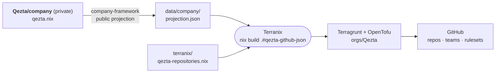
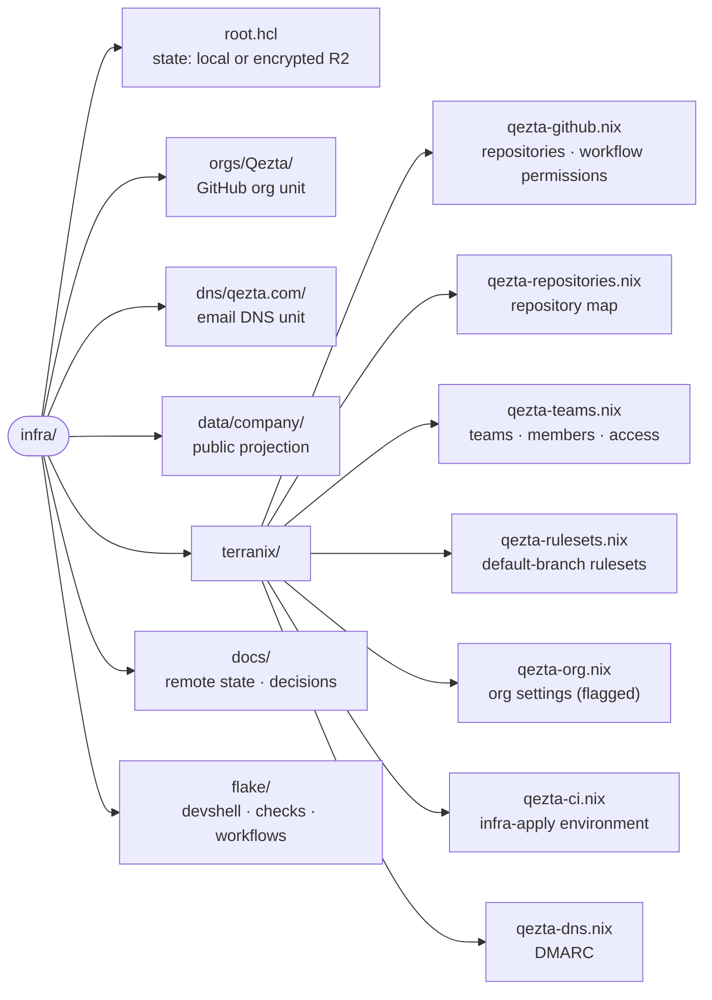
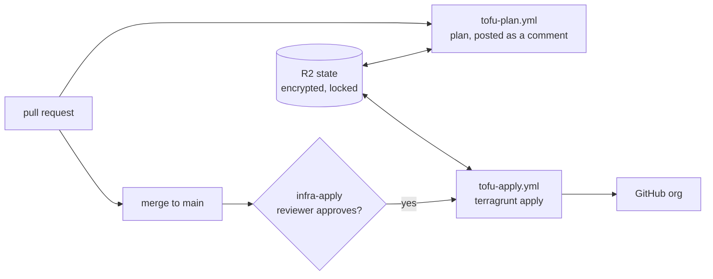

<div id="top">
    <div align="center">
        
        <h1 align='center'>infra</h1>
        <strong>Qezta's infrastructure as code: GitHub org, repositories, teams and DNS (OpenTofu, Terranix, Terragrunt)</strong>
    </div>

</div>

______________________________________________________________________

<div align='center'>
    <a href="https://github.com/Qezta/infra/stargazers">
        
    </a>
    <a href="https://github.com/Qezta/infra/">
        
    </a>
    <a href="https://github.com/nixos/nixpkgs">
        
    </a>
    <a href="https://opentofu.org">
        
    </a>
    
</div>

______________________________________________________________________

<div align='center'>
    <a href="https://github.com/Qezta/infra/actions/workflows/flake-check.yml">
        
    </a>
    <a href="https://github.com/Qezta/infra/actions/workflows/tofu-plan.yml">
        
    </a>
</div>

______________________________________________________________________

## Contents

- [Overview](#overview)
- [Quick Start](#quick-start)
- [Architecture](#architecture)
- [Project Structure](#project-structure)
- [GitHub Organization](#github-organization)
- [DNS](#dns)
- [State and CI](#state-and-ci)
- [Decisions](#decisions)

______________________________________________________________________

## Overview

Everything about the [Qezta](https://github.com/Qezta) GitHub organization and
`qezta.com` that can be declared, is declared here and applied with
[OpenTofu](https://opentofu.org) through [Terragrunt](https://terragrunt.com).
Configuration is written in Nix with [Terranix](https://terranix.org) and
compiled to OpenTofu JSON at plan time.

Who belongs to which team comes from the private
[Qezta/company](https://github.com/Qezta/company) spec, built with
[company-framework](https://github.com/Qezta/company-framework). Only its
public-safe projection (roles, team names, GitHub logins, repositories) is
committed here.

## Quick Start

```sh
nix develop                      # opentofu, terragrunt, gh, alejandra
cd orgs/Qezta
terragrunt plan                  # uses GITHUB_TOKEN_QEZTA, else `gh auth token`
```

Org settings, Actions policy and membership need a token with `admin:org`
and are off unless `QEZTA_MANAGE_ORG_SETTINGS=true` (with
`QEZTA_ORG_BILLING_EMAIL` set). Never commit state, `.tfvars` or tokens.

## Architecture



## Project Structure



## GitHub Organization

| What | Where | Notes |
| --- | --- | --- |
| Repositories | `terranix/qezta-repositories.nix` | `existing = false` creates a repo instead of importing it; `prevent_destroy` on all |
| Teams and members | `data/company/projection.json` | Flat teams (`founders`, `engineering`, `security`); org owners are maintainers |
| Repository access | derived | Each system's owner team gets its role's permission; CODEOWNERS teams get at least `push` |
| Rulesets | `terranix/qezta-rulesets.nix` | Public repos: PRs required, no force push or deletion; admins bypass only within a PR |
| Org settings | `terranix/qezta-org.nix` | Behind a flag; requiring 2FA must be done by hand (not in the API) |

## DNS

`qezta.com` uses Spaceship DNS. `dns/qezta.com` manages individual email
records with `spaceship_dns_record` (never the plural resource, which would
delete every record it doesn't list). It currently adds a monitoring-only
DMARC record; MX and SPF belong to Spaceship email forwarding. Needs
`SPACESHIP_API_KEY` and `SPACESHIP_API_SECRET`.

## State and CI

State is local today. [docs/remote-state.md](docs/remote-state.md) describes
the move to an encrypted, locked Cloudflare R2 backend. Once it's done and the
`REMOTE_STATE_ENABLED` variable is set, pull requests get a `tofu plan`
comment and merges to `main` apply after approval in the `infra-apply`
environment.



## Decisions

- [0001: GitHub teams and access come from the company projection](docs/decisions/0001-org-from-company-projection.md)
- [0002: Flat GitHub teams](docs/decisions/0002-flat-github-teams.md)
- [0003: CODEOWNERS through pull requests](docs/decisions/0003-codeowners-sync-via-ci.md)

<div align="right">

[![][back-to-top]](#top)

</div>

[back-to-top]: https://img.shields.io/badge/-BACK_TO_TOP-151515?style=flat-square&color=purple
