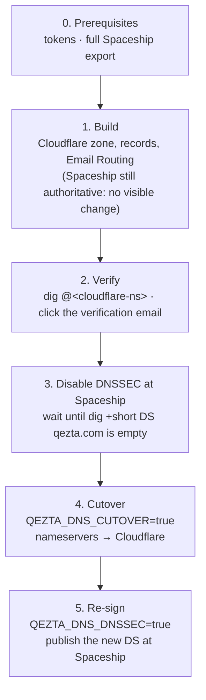

# Moving qezta.com DNS and email to Cloudflare

`dns/qezta.com` moves qezta.com from Spaceship DNS to Cloudflare and replaces
Spaceship email forwarding with Cloudflare Email Routing, so every DNS record
and every forwarded address is code. Spaceship stays the registrar.



## 0. Prerequisites

Credentials live encrypted in DivitMittal/infra-nixCfg-secrets and are
decrypted at run time by `scripts/read-secret` (needs the agenix key at
`~/.ssh/agenix/id_ed25519` and a checkout of that repo):

| Secret | Use |
| --- | --- |
| `cloud/cloudflare/account_id.age` | Account that owns the zone |
| `cloud/cloudflare/api_token.age` | Account token: Zone, DNS, Zone Settings, Email Routing Rules/Addresses: Edit |
| `cloud/cloudflare/email_forward_to.age` | Inbox every forwarded address delivers to |
| `cloud/spaceship/api_key.age`, `api_secret.age` | Registrar: the nameserver change in stage 4 |

The records in `terranix/qezta-dns.nix` match a full export from the
Spaceship API (2026-11-19).

## 1. Build (no visible change)

```sh
cd dns/qezta.com
terragrunt plan     # zone, 5 records, Email Routing, 6 forward rules
terragrunt apply
terragrunt output name_servers
```

Spaceship is still authoritative, so nothing changes for visitors yet.

## 2. Verify

- Ask Cloudflare's nameservers directly and compare with today's answers:
  `dig @<cloudflare-ns> qezta.com A`, `www`, `divit`, `TXT`, `MX`.
- Click the verification link Cloudflare sends to the forwarding inbox.
  Rules forward nothing until the address is verified.

## 3. Disable DNSSEC at Spaceship

Domain → DNSSEC → disable. The `.com` registry keeps serving the old DS
record until its TTL passes (allow up to two days). Wait until
`dig +short DS qezta.com` prints nothing. The cutover is refused until then
(a Terragrunt hook checks).

## 4. Cutover

```sh
QEZTA_DNS_CUTOVER=true terragrunt apply
```

Points the registrar's nameservers at Cloudflare. Resolvers switch as the old
NS records expire (up to two days). Mail sent during the switch may arrive
through either path; both forward to the same inbox.

## 5. Re-sign with DNSSEC

```sh
QEZTA_DNS_CUTOVER=true QEZTA_DNS_DNSSEC=true terragrunt apply
terragrunt output ds_record
```

Add that DS record at Spaceship (Domain → DNSSEC). Keep both flags set from
now on.

## Rollback

Before stage 4, nothing user-visible has changed: destroy or ignore the zone.
After stage 4, set the nameservers back to `launch1.spaceship.net` and
`launch2.spaceship.net` in the Spaceship dashboard; Spaceship's records and
forwarding are untouched by this migration.
